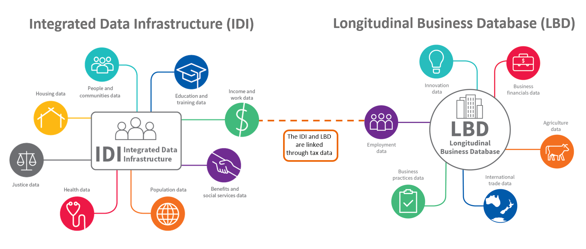

# Data: Research Data Landscape in New Zealand

::: notes
**Key message:** Data is the first practical component of public sector Data Science, alongside Algorithm and Platform.

- Governance determines how data can be accessed, managed, and used.
- NZ offers both open datasets and restricted research data.
- The IDI demonstrates how large-scale data integration operates within a governed environment.

**Transition:** We begin with the available research data sources before focusing on the IDI.
:::

---

## Research Data Sources in Aotearoa NZ

- **Open and publicly accessible data:**
  - [data.govt.nz](https://data.govt.nz) — Government open data portal.
  - [Aotearoa Data Explorer](https://www.stats.govt.nz/) — Official population, social, and economic statistics.
  - [Environmental Data](https://niwa.co.nz/) — Climate, water, and environmental information.
  - [Health Data](https://www.health.govt.nz/) — Health statistics and publications.
  - [Education Counts](https://www.educationcounts.govt.nz/) — Education statistics and indicators.

::: {.fragment}
- **Restricted research data:** Stats NZ's **Integrated Data Infrastructure (IDI)** and **Longitudinal Business Database (LBD)**.
:::

::: notes
**Key message:** NZ provides both open data and controlled-access microdata.

**Examples:**
- **Open data:** Download regional population and health statistics to visualise diabetes prevalence or socioeconomic inequalities.
- **Restricted data:** Study individual-level relationships between income, education, and health outcomes using linked IDI records.

**Distinction:** Open data supports accessible analysis; restricted microdata enables more detailed research but requires approval and safeguards.

**Transition:** Our main focus is the IDI, one of NZ's most important research data infrastructures.
:::

---

## What are the IDI and LBD?

- **IDI** → Linked data about **people and households**.
- **LBD** → Linked data about **businesses and economic activity**.

::: notes
**Key message:** IDI and LBD enable researchers to analyse linked information across time and domains.

**Examples:**
- **IDI:** Link health, education, income, and housing records to study factors associated with diabetes.
- **LBD:** Analyse how business characteristics, innovation, and employment change over time.

**Important:** De-identified data is not necessarily anonymous. Researchers must follow confidentiality and access requirements.

**Transition:** The real value comes from linking information that would otherwise remain in separate datasets.
:::

---

## Why the IDI Matters

- **Integrated:** Connects information across health, education, employment, housing, and other domains.
- **Longitudinal:** Tracks outcomes and changes **over time**.
- **Population-scale:** Supports research across large segments of New Zealand's population.
- **Policy-relevant:** Enables cross-sector research and programme evaluation [@milne2019data; @milne2022longitudinal].

::: {.fragment}
**Key strength:** Understanding complex social outcomes through **linked, longitudinal data**.
:::

::: notes
**Key message:** IDI allows researchers to study relationships across sectors and over time.

**Examples:**
- **Health:** Investigate how income, housing, and education relate to future diabetes risk.
- **Education:** Examine transitions from secondary education to tertiary study and employment.
- **Policy:** Evaluate whether participation in a government programme is associated with improved long-term outcomes.

**Data Science relevance:** Supports predictive modelling, longitudinal analysis, and causal research designs, although data linkage alone does not establish causality.

**Caution:** The IDI is not a complete census of every activity or person; coverage varies by dataset.
:::

---

## IDI Governance: The Five Safes

Access to the IDI is governed by Stats NZ's **Five Safes framework** [@stats_nz_idi].

| **Principle** | **Key Requirement** |
|:----------------|:------------------------------|
| **Safe People** | Approved and appropriately trained researchers |
| **Safe Projects** | Approved research with public benefit |
| **Safe Data** | Data prepared to minimise identification risks |
| **Safe Settings** | Secure, controlled research environments |
| **Safe Outputs** | Confidentiality-checked research results |

::: {.fragment}
**The Five Safes balance research utility with privacy and confidentiality protection.**
:::

::: notes
**Key message:** The Five Safes operationalise governance throughout the research lifecycle.

**Example — Diabetes research using IDI:**
- **People:** Researchers complete training and obtain approval.
- **Projects:** The diabetes research proposal is assessed for public benefit and appropriate use.
- **Data:** Researchers access de-identified, linked health and socioeconomic records.
- **Settings:** Analysis takes place in an approved secure environment.
- **Outputs:** Tables, figures, and model results undergo confidentiality checks before release.

**Important:** No single safeguard is sufficient. Protection comes from combining all five.

**Connection:** This is a practical application of the governance concepts introduced in Module 1.
:::

---

## Limitations of the IDI

- **Coverage & Quality:** Missing information, linkage errors, and administrative data limitations.
- **Timeliness:** Updates and reporting lags vary across datasets.
- **Access & Security:** Research approvals, secure environments, and output checks.
- **Computing:** Software, infrastructure, and resource constraints.
- **Equity & Governance:** Māori Data Sovereignty and representational concerns.

::: {.fragment}
**Key challenge:** Balancing **data utility, accessibility, privacy, and equity**.
:::

::: notes
**Key message:** The IDI is powerful, but researchers must understand its limitations.

**Examples:**
- **Coverage:** Hospital data captures many serious conditions, but detailed primary care consultations and clinical notes are generally unavailable.
- **Quality:** Administrative records may contain missing values, inconsistent coding, and linkage errors that affect AI predictions.
- **Timeliness:** Some datasets are updated later than others, limiting real-time analysis.
- **Access:** Project approval and output checking can slow research and collaboration.
- **Computing:** Large-scale machine learning may be constrained by available computing resources and approved software.
- **Equity:** Incomplete or uneven representation can affect Māori and other population groups. Māori data governance also requires attention beyond statistical representativeness.

**Discussion:** How can we improve research accessibility and AI innovation without compromising privacy or Māori Data Sovereignty?

**Takeaway:** The IDI is valuable national research infrastructure, but its limitations must be considered when designing research and interpreting results.
:::

---
