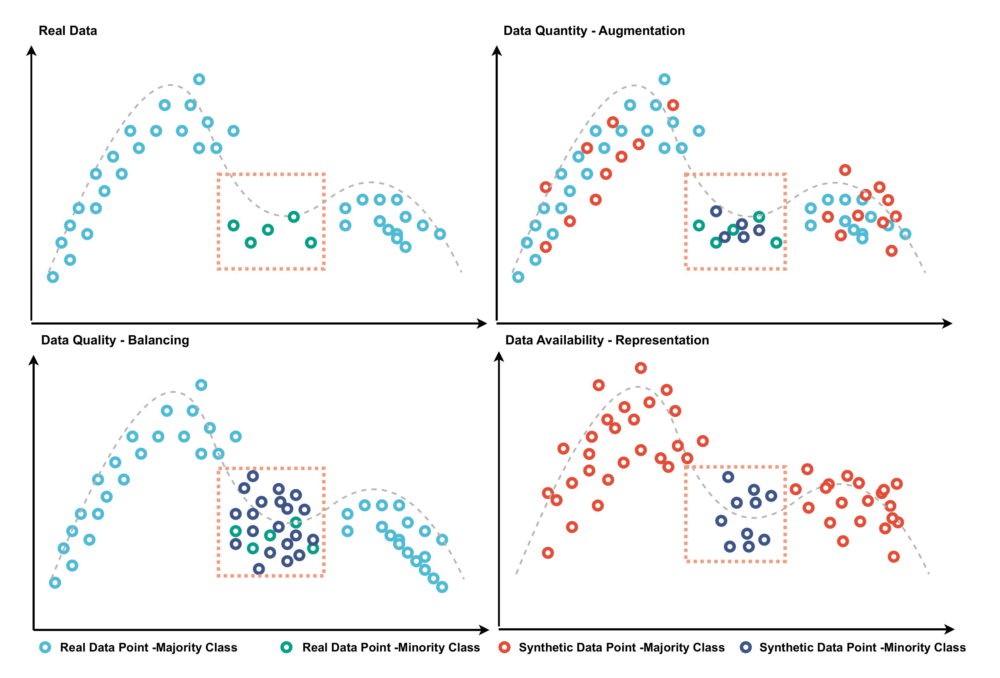
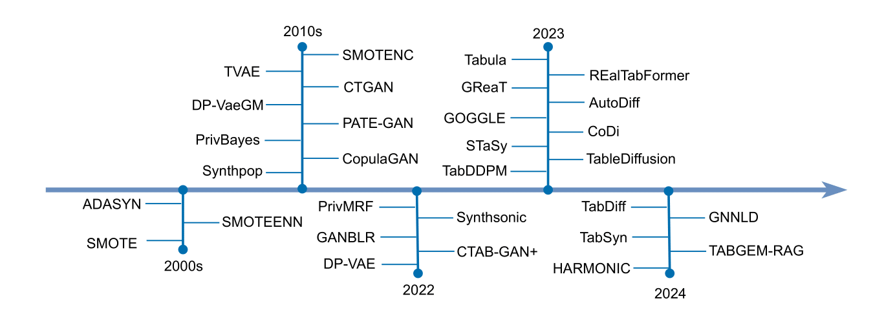
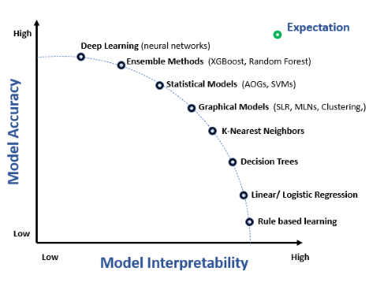

# Algorithm: Synthetic Data, XAI & AI Adoption

::: notes
**Key message:** Algorithms turn governed data into insights, predictions, and services.

Three topics:
- **Synthetic Data:** Improve data availability and support privacy-conscious development.
- **XAI:** Make model behaviour more understandable.
- **AI Adoption:** Translate technical capabilities into responsible public sector practice.

**Connection:** Data enables algorithms; governance determines how they can be responsibly developed and deployed.
:::

---

## Synthetic Data: Definition & Motivation

**Synthetic data** = Artificially generated data that mimics patterns and relationships in real datasets [@raghunathan2021synthetic].

**Why generate it?**
- **Quantity:** Limited observations and rare events.
- **Quality:** Missing values and imbalanced datasets.
- **Availability:** Restricted access to sensitive data.

::: {.fragment}
[{width="65%"}](https://doi.org/10.1007/978-981-96-8183-9_28)
:::

::: notes
**Key message:** Synthetic data can help overcome limitations in real-world datasets.

**Examples:**
- **Quantity:** Rare disease datasets may have too few observations for robust model development.
- **Quality:** Synthetic generation may help explore class imbalance, but cannot automatically fix source-data bias.
- **Availability:** Researchers could use an approved synthetic IDI-like dataset to develop SQL queries and test analytical pipelines outside secure environments.

**Important:** Synthetic data is not automatically anonymous or privacy-preserving. Generative models may memorise or disclose sensitive information.
:::

---

## Synthetic Data: Methods & Evolution

- **Statistical methods** → Sampling, probabilistic models, copulas.
- **Deep generative models** → VAEs and GANs.
- **Recent approaches** → Diffusion models and LLMs.

[{width="85%"}](https://doi.org/10.1007/978-981-96-8183-9_28)

::: notes
**Key message:** Tabular Data Synthesis (TDS) uses increasingly sophisticated methods to capture relationships between variables.

**Examples:**
- **Statistical:** Copulas model dependencies among age, income, and health outcomes.
- **VAEs/GANs:** Learn complex nonlinear relationships in mixed-type data.
- **Diffusion:** Generate synthetic records through iterative denoising.
- **LLMs:** Generate structured records using prompts or learned patterns.

**Caution:** These methods overlap historically. Newer approaches are not necessarily better for every dataset.

**Transition:** Regardless of the generation method, synthetic data must be evaluated before use.
:::

---

## Synthetic Data: Value & Evaluation

**Public sector applications:**
- **Augment** → Support development with limited data.
- **Balance** → Explore under-represented groups.
- **Enable Access** → Develop and test without directly sharing real records.

**Four evaluation dimensions:**

| **Dimension** | **Key Question** |
|:--------------|:-----------------|
| **Fidelity** | Does it resemble real data? |
| **Utility** | Is it useful for analysis and ML? |
| **Privacy** | Could real individuals be exposed? |
| **Fairness** | Are biases reproduced or amplified? |

::: notes
**Key message:** Synthetic data offers opportunities, but quality and privacy require separate evaluation.

**Examples:**
- **Fidelity:** Compare distributions, correlations, and relationships between real and synthetic health records.
- **Utility:** Train a diabetes prediction model on synthetic data and evaluate it on held-out real data (TSTR).
- **Privacy:** Test membership inference, attribute inference, and record linkage risks.
- **Fairness:** Compare model performance across Māori, Pacific, and other population groups.

**Public sector example:** A synthetic IDI proxy could support code development and training outside secure labs, subject to disclosure-risk assessment and approval.

**Important:** Synthetic data does not automatically resolve privacy obligations or Māori Data Sovereignty concerns.

**Takeaway:** High fidelity does not guarantee utility, privacy, or fairness.
:::

---

## XAI: Why Explainability Matters

- **Predictive performance** alone is not sufficient for high-impact decisions.
- **Interpretability** supports transparency, trust, and human oversight.

::: {.fragment}
**Key consideration:** Balancing **accuracy, interpretability, and accountability**.
:::

::: notes
**Key message:** Government AI must balance predictive performance with the need to understand and justify decisions.

**Example — Health risk prediction:**
- **Logistic regression:** Often easier to interpret, with clear model coefficients.
- **Random forest / XGBoost:** Can capture complex relationships but may require post-hoc explanations.
- **Deep learning:** Can model complex patterns but is often harder to interpret directly.

**Public sector example:**
A government agency develops an AI model to identify people at risk of long-term unemployment.

A complex model achieves 86% accuracy, while an interpretable model achieves 84%.

Is the 2% improvement worth the additional complexity, especially if predictions influence access to support services?

**Important caveat:** The diagram illustrates a common perceived trade-off, not a universal rule. More complex models are not necessarily more accurate.

**Transition:** XAI methods such as SHAP and LIME help explain complex model predictions.
:::

---

## XAI: Methods & Government Applications

| **Method** | **Purpose** |
|:-----------|:------------|
| **Linear models / Trees** | Intrinsically interpretable predictions |
| **SHAP** | Feature contributions |
| **LIME** | Local prediction explanations |
| **PDP** | Average model response to features |
| **Counterfactuals** | Changes that alter predictions |

::: {.fragment}
**Applications:** Health risk prediction • Tax compliance • Social services
:::

::: notes
**Key message:** Different XAI methods explain different aspects of model behaviour.

**Examples:**
- **SHAP (Health):** Identify variables contributing to an individual's predicted diabetes risk.
- **LIME (Tax):** Explain why an anomaly detection model flagged a transaction for further review.
- **PDP (Social services):** Explore how predicted outcomes vary with income or employment history.
- **Counterfactuals:** Identify feasible changes that would alter a model's prediction.

**Limitations:**
- SHAP contributions are not causal effects.
- LIME explanations can vary with sampling.
- PDP can be misleading with correlated variables.
- Counterfactual changes may be unrealistic or inappropriate.

**Government relevance:** XAI supports transparency, scrutiny, and human oversight, but must be combined with model validation and governance.
:::

---

## AI Adoption in Government: Opportunities

AI can improve public services through:

- **Productivity** → Automate routine administrative tasks.
- **Decision Support** → Assist evidence-based decisions.
- **Service Delivery** → Improve responsiveness and accessibility.
- **Policy Insights** → Analyse complex population and economic trends.

::: {.fragment}
**Goal:** Better public outcomes, not simply more automation.
:::

::: notes
**Key message:** AI adoption should be driven by public value and clearly defined problems.

**Examples:**
- **Productivity:** Summarise lengthy policy documents or assist with drafting routine reports, with human review.
- **Decision Support:** Predict hospital demand to support workforce and resource planning.
- **Service Delivery:** Help people navigate government information and services through an AI assistant.
- **Policy Insights:** Analyse employment, education, and health patterns to support policy development.

**Discussion:** Which tasks should AI automate, and which should remain under human decision-making?

**Important:** AI-generated outputs require appropriate verification, especially in high-impact settings.
:::

---

## AI Adoption in Government: Challenges

- **Data** → Quality, availability, privacy, and sovereignty.
- **Algorithms** → Bias, explainability, reliability, and safety.
- **Platforms** → Security, infrastructure, and integration.
- **People & Governance** → Skills, accountability, trust, and oversight.

::: {.fragment}
**Key challenge:** Moving from promising AI pilots to safe, sustainable public services.
:::

::: notes
**Key message:** AI adoption is an organisational and governance challenge, not only a technical one.

**Examples:**
- **Data:** Sensitive government records cannot simply be uploaded into an external AI service.
- **Algorithms:** An eligibility prediction model may reproduce historical inequalities.
- **Platforms:** An AI prototype may work in a notebook but lack secure deployment, monitoring, and integration.
- **People:** Staff need training to recognise hallucinations, limitations, and inappropriate reliance on AI.

**NZ context:** Consider the Privacy Act, Algorithm Charter commitments where applicable, Māori Data Sovereignty, and agency-specific security and assurance requirements.

**Takeaway:** Successful AI adoption requires coordinated development across Data, Algorithm, Platform, and Governance.
:::

---

## From Experimentation to Responsible AI Adoption

**A practical pathway:**

1. **Identify** → Define the public problem and expected benefit.
2. **Assess** → Evaluate data readiness, risks, and governance.
3. **Pilot** → Develop and validate with appropriate users.
4. **Deploy** → Implement secure systems with human oversight.
5. **Monitor** → Evaluate performance, fairness, and outcomes.

::: {.fragment}
**Responsible AI = Public Value + Technical Assurance + Governance**
:::

::: notes
**Key message:** AI adoption is a lifecycle, not a one-off technology purchase.

**Example — Government AI assistant:**
1. **Identify:** Reduce time spent searching policy guidance.
2. **Assess:** Classify information and determine which documents can be used.
3. **Pilot:** Test answer accuracy, hallucinations, and user experience.
4. **Deploy:** Apply access controls, logging, and human escalation.
5. **Monitor:** Track errors, usage, user feedback, and changes to source documents.

**Final takeaway:** Synthetic data helps address data access challenges; XAI supports model understanding; governance and platforms enable responsible deployment.

**Transition:** Next, we examine the Platform component — the infrastructure required to develop and operate AI securely.
:::

---
